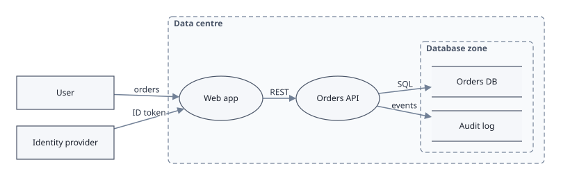

# graphedwright

A Go library that draws directed graphs as SVG and edits them in the
browser. One graph document is drawn the same in a web page, on a
server, from a command line and in a test. It compiles to WebAssembly
with the Go or the TinyGo toolchain. Besides the standard library it
imports only merilo's `fsm`, which itself imports nothing.

<p>


</p>

- **Schemas** say what a diagram may hold: its kinds of shape and line,
  their ports and attributes, and rules such as "no cycles". The editor
  refuses anything a schema doesn't allow and says why. There are
  built-in schemas for general diagrams, UML use case diagrams and
  STRIDE threat models.
- **Every change is a command,** so everything can be undone, including
  layouts.
- **Layered layout,** left to right or top to bottom. Long edges are
  routed around the shapes they pass, shapes you've placed stay put, and
  containers such as system or trust boundaries are laid out as a block.
- **SVG** written as text, the same byte for byte everywhere, with every
  element addressable by ID and class for styling and scripting.
- **An editor in the browser:**
  - adding and connecting shapes, and choosing the kind of line;
  - moving shapes into and out of containers, and resizing shapes and
    containers by a corner handle;
  - double-clicking or typing to edit a label;
  - a properties panel for the selected shape or line;
  - pan and zoom, by wheel, keys or buttons; undo and redo.
- **JSON documents** that are read strictly: every size is checked
  against fixed capacities, and the reader is fuzzed.
- **Small and predictable:** capacities are fixed up front and nothing
  allocates while editing. The TinyGo build is under 600 KB.

## Quick start

In Go, a document is built from commands, laid out and drawn:

```go
schema := gw.Schema{
	VertexKinds: []gw.VertexKind{{Name: "box", Shape: gw.RoundRect, Size: gw.Size{W: 120, H: 36}}},
	EdgeKinds:   []gw.EdgeKind{{Name: "arrow", Arrow: true}},
}
d, _ := gw.New(schema, gw.Caps{})
ch, _ := d.Apply(gw.Command{Op: gw.AddVertex, Kind: 0, Text: "hello"})
hello := ch.Vertices[0]
ch, _ = d.Apply(gw.Command{Op: gw.AddVertex, Kind: 0, Text: "world"})
world := ch.Vertices[0]
d.Apply(gw.Command{Op: gw.AddEdge, Kind: 0, From: hello, To: world, FromPort: gw.None, ToPort: gw.None})

layout.New(d.Caps()).Run(d, layout.Options{})
svg.Render(d, svg.Options{Style: svg.Stylesheet}, os.Stdout)
```

In a web page, the browser build mounts an editor in an element:

```js
const g = graphedwright.create(document.getElementById("graph"), { schema: "use-case" }).ok;
graphedwright.load(g, documentJSON);
graphedwright.on(g, "select", () => showProperties(graphedwright.properties(g).ok));
```

From a shell, the command draws a document:

```sh
go run ./cmd/graphedwright render --css -f web/examples/use-case.json > use-case.svg
```

## Documentation

- **[Tutorial](docs/tutorial.md):** draw a dependency tree from Go, then
  edit it in a web page.
- **[Concepts](docs/concepts.md):** documents, schemas, commands and
  undo, layout, containers.
- **[Schemas](docs/schemas.md):** defining your own, and the built-in
  ones.
- **[In the browser](docs/browser.md):** the JavaScript API, the
  editor's gestures, styling.
- **[The Go API](docs/go.md):** the packages and how they fit together.
- **[Document format](docs/format.md)** and **[command line](docs/cli.md)**.

## The demo

```sh
make demo
```

This serves <http://127.0.0.1:8001/>. It has an example of each built-in
schema and a dependency tree; edit them, lay them out in either
direction, inspect them in the properties panel and export them.
`?toolchain=tinygo` switches to the TinyGo build, and `/tutorial.html`
is the tutorial's page.

## Packages

| Package | |
|---|---|
| `code.eitanity.com/graphedwright` | the document, schema, commands and undo |
| `…/layout` | the layered layout |
| `…/svg` | the renderer, hit testing, the default stylesheet |
| `…/doc` | the JSON format and the built-in schemas |
| `…/edit` | the editor, driven by input events |
| `…/dom` | the browser binding (`GOOS=js`) |
| `…/cmd/graphedwright` | the command line |
| `…/cmd/graphedwright-wasm` | the browser build's entry point |

## Building and testing

You need Go 1.27 or later. `make ci` runs every check that runs on each
push:
- module verification, and builds for the host, for `js/wasm` and
  `wasip1/wasm` with Go, and with TinyGo;
- formatting, vet, the linters and the project's own analyzers
  (`internal/lint`, a separate module);
- the escape and allocation checks on the render and event paths;
- the race detector, the fuzzers, the WebAssembly tests under wazero
  and the vulnerability scan;
- the TinyGo size budget.

`make wasm-smoke` runs the browser smoke test under both toolchains in
headless Firefox through geckodriver. TinyGo is pinned in the Makefile,
and `make tools` says where to get it.

## Licence

Copyright 2026 Eitanity Systems VCC.

graphedwright is licensed under the Apache License, Version 2.0 (see
`LICENSE` and `NOTICE`).
