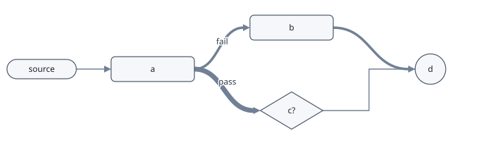
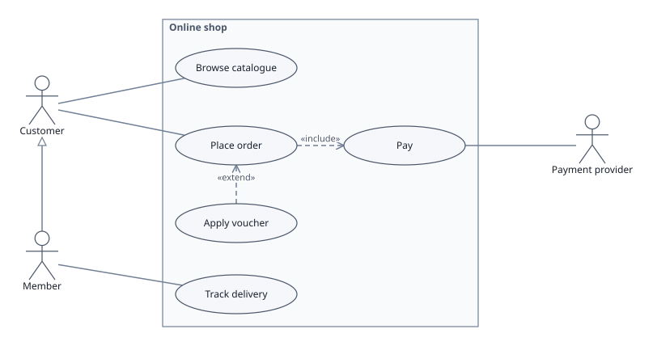
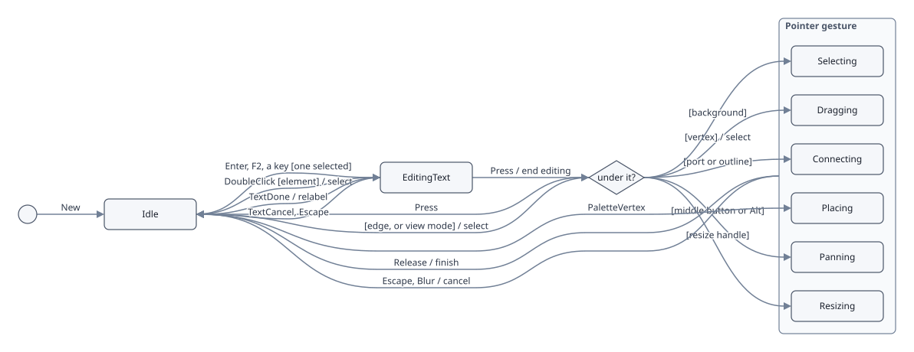

# Schemas

A schema says what a document may contain and how it looks: its vertex
kinds and edge kinds, their shapes, ports and attributes, and the rules
a document keeps. The editor's palette is the schema's kinds, in order.

A schema is defined in Go as a `gw.Schema`, or in a web page as a plain
object. Documents name their schema rather than embed it, so whoever
reads a document supplies the schema under that name.

## Built-in schemas

`doc.Builtin()` returns four schemas that the command line and the
browser build know without being told. The demo page has an example of
each in [`web/examples`](../web/examples).

### `basic`

General diagrams: any vertex may join any other, with free attributes.

| Vertex kind | Shape | Size |
|---|---|---|
| `box` | rounded rectangle | 120 × 36 |
| `pill` | pill | 100 × 28 |
| `diamond` | diamond | 90 × 54 |
| `circle` | ellipse | 44 × 44 |
| `group` | dashed rounded rectangle, a container that holds any kind | 200 × 120 |

| Edge kind | Drawn as |
|---|---|
| `arrow` | a straight arrow |
| `line` | a straight line |
| `curve` | a curved arrow, its width following its weight |
| `wire` | right angles, no arrow |



### `use-case`

UML use case diagrams.

| Vertex kind | Shape | Notes |
|---|---|---|
| `actor` | a stick figure with its label below | |
| `use case` | an ellipse, 150 × 48 | |
| `system` | a rectangle | a container that holds use cases |

| Edge kind | Joins | Drawn as |
|---|---|---|
| `association` | an actor to a use case | a plain line |
| `include` | use case to use case | dashed, open arrowhead, `«include»` |
| `extend` | use case to use case | dashed, open arrowhead, `«extend»` |
| `generalisation` | actor to actor, or use case to use case | hollow arrowhead |



### `threat-model`

Data flow diagrams for STRIDE threat modelling. Each element carries
what an analysis reads, and a free-text list of threats.

| Vertex kind | Shape | Attributes |
|---|---|---|
| `external entity` | rectangle | `trust` (untrusted, partial, trusted), `threats` |
| `process` | ellipse | `trust`, `threats` |
| `data store` | a box with a line above and below | `encrypted` (unknown, yes, no), `threats` |
| `trust boundary` | dashed rounded rectangle, a container that nests | `trust` |

| Edge kind | Joins | Attributes |
|---|---|---|
| `data flow` | entities, processes and stores | `protocol` (text), `encrypted`, `authenticated` (unknown, yes, no), `threats` |


### `state-machine`

UML state machine diagrams. A state carries its behaviour as text, and
a transition its trigger, written `event [guard] / actions` in UML.

| Vertex kind | Shape | Notes |
|---|---|---|
| `initial` | a small circle | where the machine starts; takes no incoming transition |
| `state` | rounded rectangle | `entry`, `exit` and `internal` (text): what it does on entering, on leaving, and for events that leave it where it is |
| `choice` | diamond | a branch on guards |
| `final` | a circle | where the machine ends; takes no outgoing transition |
| `composite state` | rounded rectangle, a container that nests | holds states, choices, initial and final states; `entry`, `exit`, `internal` |

| Edge kind | Joins | Attributes |
|---|---|---|
| `transition` | from an initial state, a state, a choice or a composite state, to a state, a choice, a final state or a composite state; curved, with an arrowhead | `event`, `guard`, `actions` (text) |

The example is graphedwright's own editor: the states between events,
and what a press, a release, a key or the host's label input does in
each.



## Defining a schema in Go

```go
schema := gw.Schema{
	VertexKinds: []gw.VertexKind{
		{Name: "source", Shape: gw.Pill, Size: gw.Size{W: 96, H: 24}, Root: true},
		{Name: "step", Shape: gw.RoundRect, Size: gw.Size{W: 120, H: 36},
			Ports: []gw.Port{{Name: "in", Side: gw.Left}, {Name: "out", Side: gw.Right, Max: 2}},
			Attrs: []gw.AttrSpec{
				{Key: "p", Kind: gw.Number, Required: true, Default: "0.5"},
				{Key: "mode", Kind: gw.Choice, Choices: []string{"fast", "slow"}},
			}},
		{Name: "stage", Shape: gw.RoundRect, Size: gw.Size{W: 200, H: 120}, Container: true, Contains: []gw.KindIndex{1}},
	},
	EdgeKinds: []gw.EdgeKind{
		{Name: "feeds", From: []gw.KindIndex{0}, To: []gw.KindIndex{1}, Arrow: true},
		{Name: "then", From: []gw.KindIndex{1}, Route: gw.Curve, Arrow: true, Weighted: true},
	},
	Acyclic: true,
}
d, err := gw.New(schema, gw.Caps{})
```

`gw.New` checks the schema and refuses one that is inconsistent: no
vertex kinds, two kinds with one name, a kind index out of range, a
required attribute without a default, a default its own kind refuses,
and so on. The error names the kind and the problem.

Kinds are referred to by index (`gw.KindIndex`) in the schema and in
commands.

### `Schema`

| Field | Meaning |
|---|---|
| `VertexKinds` | the vertex kinds, the palette's shapes in order; at least one |
| `EdgeKinds` | the edge kinds, the palette's lines in order |
| `Acyclic` | an edge that would close a cycle is refused |
| `Connected` | every vertex should be reachable from a root kind; a warning that `Document.Unreachable` reports, not a refusal |

### `VertexKind`

| Field | Meaning |
|---|---|
| `Name` | the palette entry, the SVG class (with spaces as `_`), and the name in documents |
| `Shape` | `Rect`, `RoundRect`, `Pill`, `Diamond`, `Circle` (an ellipse filling the size), `Actor` (a stick figure, label below) or `DataStore` (a line above and a line below) |
| `Size` | a new vertex's width and height; a vertex can be resized |
| `Ports` | named places on the sides where edges attach: `{Name, Side, Max}`, with `Side` one of `Left`, `Right`, `Top`, `Bottom`, and `Max` the edges it takes, 0 for any. A side's ports are spaced evenly along it |
| `Attrs` | the attributes the kind takes (below) |
| `Root`, `Leaf` | a root kind takes no incoming edge; a leaf kind no outgoing one |
| `Max` | the most vertices of the kind a document holds; 0 for any number |
| `Dashed` | the outline is dashed |
| `Container` | the kind holds other vertices ([Concepts](concepts.md#containers)) |
| `Contains` | the kinds a container may hold; empty for any |

### `EdgeKind`

| Field | Meaning |
|---|---|
| `Name` | the palette entry, the SVG class and the name in documents |
| `From`, `To` | the vertex kinds allowed at each end; empty for any |
| `Route` | `Straight`, `Curve` or `Orthogonal` |
| `Arrow` | draws an arrowhead at the end |
| `Head` | `FilledHead` (the default), `OpenHead` or `HollowHead` |
| `Dashed` | the line is dashed |
| `Stereotype` | text drawn on every edge of the kind, such as `«include»` |
| `Weighted` | the stroke width follows the edge's weight, 1 to 7 against the heaviest |
| `Attrs` | the attributes the kind takes |

### `AttrSpec`

| Field | Meaning |
|---|---|
| `Key` | the attribute's name: lowercase letters, digits, `-` and `_`, and not `kind`, `from` or `to`, which the drawing uses; drawn on the SVG element as `data-<key>` |
| `Kind` | `Text` (anything), `Number` (a finite number) or `Choice` (one of `Choices`) |
| `Choices` | the values a choice allows |
| `Required` | the attribute must be present; needs a `Default` |
| `Default` | the value a new element starts with |

An element can also carry attributes its kind does not name. They are
kept, written to the document and shown as text in a properties panel.

## Defining a schema in a web page

The browser build takes the same schema as a plain object, either
passed straight to `create` or registered by name first:

```js
graphedwright.registerSchema("pipeline", {
  acyclic: true,
  vertexKinds: [
    { name: "source", shape: "pill", w: 96, h: 24, root: true },
    { name: "step", shape: "round", w: 120, h: 36,
      ports: [{ name: "in", side: "left" }, { name: "out", side: "right", max: 2 }],
      attrs: [{ key: "p", kind: "number", required: true, default: "0.5" },
              { key: "mode", kind: "choice", choices: ["fast", "slow"] }] },
    { name: "stage", shape: "round", w: 200, h: 120, container: true, contains: ["step"] },
  ],
  edgeKinds: [
    { name: "feeds", from: ["source"], to: ["step"], arrow: true },
    { name: "then", from: ["step"], route: "curve", arrow: true, weighted: true },
  ],
});
const g = graphedwright.create(el, { schema: "pipeline" }).ok;
```

The fields are those of the Go structs, in lower camel case, with these
differences:

- **Names instead of indices:** the kinds an edge joins and a container
  holds are named, not numbered.
- **Size:** it is `w` and `h`.
- **Shapes:** `"rect"`, `"round"`, `"pill"`, `"diamond"`, `"circle"`,
  `"actor"` or `"datastore"`.
- **Sides:** `"left"`, `"right"`, `"top"` or `"bottom"`.
- **Routes:** `"straight"`, `"curve"` or `"orthogonal"`.
- **Heads:** `"filled"`, `"open"` or `"hollow"`.
- **Attribute kinds:** `"text"`, `"number"` or `"choice"`.

A missing field takes the first value in each list.

A Go program built for the browser can also add schemas before the
page starts, with `dom.Register(name, schema)` followed by `dom.Main()`.
