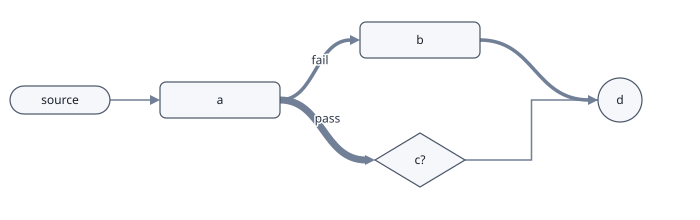
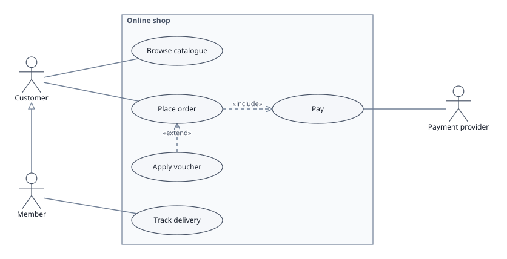
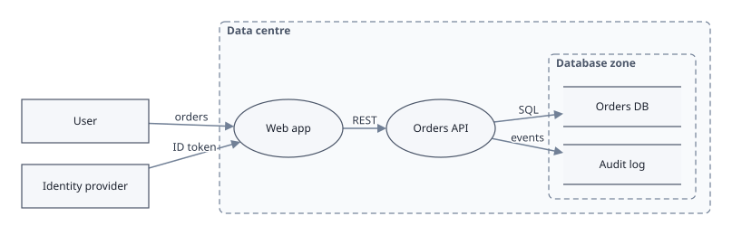
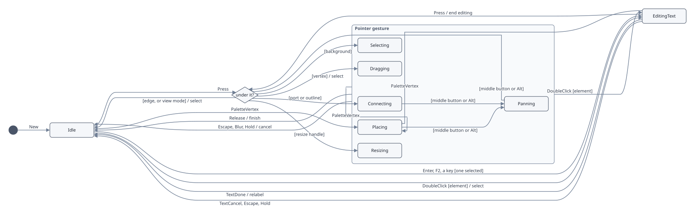
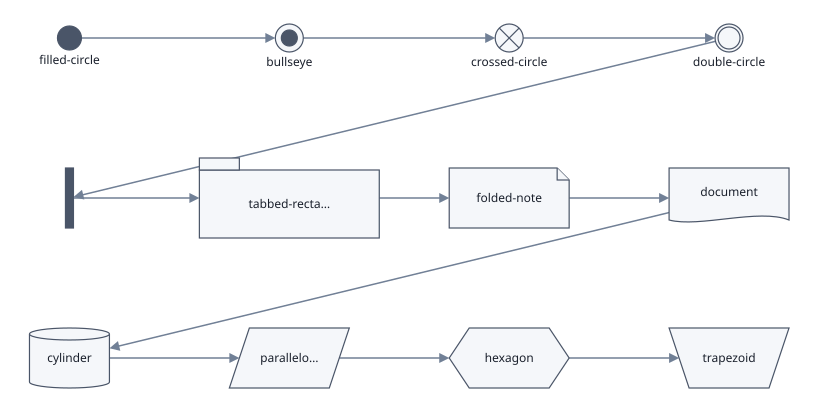

# Schemas

A schema says what a document may contain and how it looks: its vertex
kinds and edge kinds, their shapes, ports and attributes, and the rules
a document keeps. The editor's palette is the schema's kinds, in order.

A schema is defined in Go as a `gw.Schema`, or in a web page as a plain
object. Documents name their schema rather than embed it, so whoever
reads a document supplies the schema under that name.

## Built-in schemas

`doc.Builtin()` returns four schemas that the command line and the
browser build know without being told. The demo page has an example of
each in [`web/examples`](../web/examples).

### `basic`

General diagrams: any vertex may join any other, with free attributes.

| Vertex kind | Shape | Size |
|---|---|---|
| `box` | rounded rectangle | 120 × 36 |
| `pill` | pill | 100 × 28 |
| `diamond` | diamond | 90 × 54 |
| `circle` | ellipse | 44 × 44 |
| `group` | dashed rounded rectangle, a container that holds any kind | 200 × 120 |

| Edge kind | Drawn as |
|---|---|
| `arrow` | a straight arrow |
| `line` | a straight line |
| `curve` | a curved arrow, its width following its weight |
| `wire` | right angles, no arrow |



### `use-case`

UML use case diagrams.

| Vertex kind | Shape | Notes |
|---|---|---|
| `actor` | a stick figure with its label below | |
| `use case` | an ellipse, 150 × 48 | |
| `system` | a rectangle | a container that holds use cases |

| Edge kind | Joins | Drawn as |
|---|---|---|
| `association` | an actor to a use case | a plain line |
| `include` | use case to use case | dashed, open arrowhead, `«include»` |
| `extend` | use case to use case | dashed, open arrowhead, `«extend»` |
| `generalisation` | actor to actor, or use case to use case | hollow arrowhead |



### `threat-model`

Data flow diagrams for STRIDE threat modelling. Each element carries
what an analysis reads, and a free-text list of threats.

| Vertex kind | Shape | Attributes |
|---|---|---|
| `external entity` | rectangle | `trust` (untrusted, partial, trusted), `threats` |
| `process` | ellipse | `trust`, `threats` |
| `data store` | a box with a line above and below | `encrypted` (unknown, yes, no), `threats` |
| `trust boundary` | dashed rounded rectangle, a container that nests | `trust` |

| Edge kind | Joins | Attributes |
|---|---|---|
| `data flow` | entities, processes and stores | `protocol` (text), `encrypted`, `authenticated` (unknown, yes, no), `threats` |



### `state-machine`

UML state machine diagrams. A state carries its behaviour as text, and
a transition its trigger, written `event [guard] / actions` in UML.

| Vertex kind | Shape | Notes |
|---|---|---|
| `initial` | a filled circle (`shapes.FilledCircle`) | where the machine starts; takes no incoming transition |
| `state` | rounded rectangle | `entry`, `exit` and `internal` (text): what it does on entering, on leaving, and for events that leave it where it is |
| `choice` | diamond | a branch on guards |
| `final` | a bullseye (`shapes.Bullseye`) | where the machine ends; takes no outgoing transition |
| `composite state` | rounded rectangle, a container that nests | holds states, choices, initial and final states; `entry`, `exit`, `internal` |

| Edge kind | Joins | Attributes |
|---|---|---|
| `transition` | from an initial state, a state, a choice or a composite state, to a state, a choice, a final state or a composite state; curved, with an arrowhead | `event`, `guard`, `actions` (text) |

The example is graphedwright's own editor: the states between events,
and what a press, a release, a key, the palette, a context request or
the host's label input does in each, in edit and view mode and while
the host holds the editor.



## Defining a schema in Go

```go
schema := gw.Schema{
	VertexKinds: []gw.VertexKind{
		{Name: "source", Shape: gw.Pill, Size: gw.Size{W: 96, H: 24}, Root: true},
		{Name: "step", Shape: gw.RoundRect, Size: gw.Size{W: 120, H: 36},
			Ports: []gw.Port{{Name: "in", Side: gw.Left}, {Name: "out", Side: gw.Right, Max: 2}},
			Attrs: []gw.AttrSpec{
				{Key: "p", Kind: gw.Number, Required: true, Default: "0.5"},
				{Key: "mode", Kind: gw.Choice, Choices: []string{"fast", "slow"}},
			}},
		{Name: "stage", Shape: gw.RoundRect, Size: gw.Size{W: 200, H: 120}, Container: true, Contains: []gw.KindIndex{1}},
	},
	EdgeKinds: []gw.EdgeKind{
		{Name: "feeds", From: []gw.KindIndex{0}, To: []gw.KindIndex{1}, Arrow: true},
		{Name: "then", From: []gw.KindIndex{1}, Route: gw.Curve, Arrow: true, Weighted: true},
	},
	Acyclic: true,
}
kinds, err := gw.Compile(schema)
d, err := gw.New(kinds, gw.Caps{})
```

`gw.Compile` checks the schema and refuses one that is inconsistent: no
vertex kinds, two kinds with one name, a kind index out of range, a
required attribute without a default, a default its own kind refuses,
and so on. The error names the kind and the problem. It copies the
schema, so changing the `gw.Schema` afterwards changes nothing, and any
number of documents share the `*Kinds` it returns. `gw.New` refuses
kinds with more ports or attributes than the document's capacities
allow.

Kinds are referred to by index (`gw.KindIndex`) in the schema and in
commands.

### `Schema`

| Field | Meaning |
|---|---|
| `VertexKinds` | the vertex kinds, the palette's shapes in order; at least one |
| `EdgeKinds` | the edge kinds, the palette's lines in order |
| `Acyclic` | an edge that would close a cycle is refused |
| `Connected` | every vertex should be reachable from a root kind; a warning that `Document.Unreachable` reports, not a refusal |
| `Shapes` | shapes the schema provides (below), which its vertex kinds name as `gw.Provided + i` |

### `VertexKind`

| Field | Meaning |
|---|---|
| `Name` | the palette entry, the name in documents, and the SVG class after `kind-`, with spaces as `_` (`kind-use_case`) |
| `Shape` | `Rect`, `RoundRect`, `Pill`, `Diamond`, `Circle` (an ellipse filling the size), `Actor` (a stick figure, label below) or `DataStore` (a line above and a line below); or `gw.Provided + i`, the schema's `i`th shape |
| `Size` | a new vertex's width and height; a vertex can be resized |
| `Ports` | named places on the sides where edges attach: `{Name, Side, Max}`, with `Side` one of `Left`, `Right`, `Top`, `Bottom`, and `Max` the edges it takes, 0 for any. A side's ports are spaced evenly along it |
| `Attrs` | the attributes the kind takes (below) |
| `Root`, `Leaf` | a root kind takes no incoming edge; a leaf kind no outgoing one |
| `Max` | the most vertices of the kind a document holds; 0 for any number |
| `Dashed` | the outline is dashed |
| `Container` | the kind holds other vertices ([Concepts](concepts.md#containers)) |
| `Contains` | the kinds a container may hold; empty for any |
| `Keyword` | text drawn on every vertex of the kind above its label, such as `«block»`, before a container's title, or above an actor's head; a kind with one, but for a container or an actor, is at least `KeywordHeight` (32) high |
| `Compartments` | keys of the kind's attributes drawn as compartments below the label, in order, each one with a value; only for a `Rect` or `RoundRect` that is not a container ([Concepts](concepts.md#schemas)) |
| `MaxWidth` | how wide compartments may make a vertex; 0 for the kind's width. A longer line is cut with an ellipsis |
| `LabelFormat` | builds the label drawn from the label as set and the attributes ([Concepts](concepts.md#schemas)); empty draws the label as set |
| `EditAttr` | an attribute of the kind that the label input edits in place of the label, for a kind whose `LabelFormat` draws it: a double-click, Enter or typing then edits that value, and the text done sets it as a `SetAttr`. Empty edits the label |

### `ShapeDef`

A schema can provide shapes of its own: paths drawn in a box, scaled to
each vertex. A start node, a package with a tab, a note with a folded
corner or a flowchart symbol is one of these.

```go
gw.ShapeDef{
	Name:    "package",
	Box:     gw.Size{W: 100, H: 60},
	Margins: [4]float64{40, 12, 0, 0}, // the tab keeps its size
	Paths: []gw.ShapePath{
		{D: "M 0 12 H 100 V 60 H 0 Z"},
		{D: "M 0 0 H 40 V 12 H 0 Z"},
	},
}
```

| Field | Meaning |
|---|---|
| `Name` | lowercase letters, digits and `-`, starting with a letter; not a built-in's (`rect`, `round`, `pill`, `diamond`, `circle`, `actor`, `datastore`) and not another shape's. The shape is drawn with the class `shape-<name>` |
| `Box` | the size the paths are drawn in, the origin at its top left; at most 10000 |
| `Margins` | left, top, right, bottom. A point within a margin keeps its distance from that side, a point between the margins scales across the middle, and an arc's radii scale as the part its end point is in. So a tab, a fold or a corner icon keeps its size, and a circle with no margins becomes the vertex's ellipse. Margins wider than the vertex shrink to fit it |
| `Paths` | up to 8, drawn in order: `{D, Fill}`. `D` takes `M`, `L`, `H`, `V`, `C`, `Q`, `A` and `Z`, absolute, at most 64 commands, every number in the box, arcs unrotated. `Fill` draws the path filled solid (`path.mark`), else as the shape is (`path.line`) |
| `Outline` | what edges are clipped to and the hit test reads: `OutlineBox` (the default), `OutlineDiamond`, `OutlineEllipse`, or `OutlinePolygon` |
| `Polygon` | with `OutlinePolygon`: a convex polygon of 3 to 16 points in the box, scaled as the paths are |
| `Label` | `LabelInside` (the default), centred between the margins and cut at that width; `LabelBelow`, under the box, as wide as it needs, with the kind's keyword over it, which a layout makes room for (`Kinds.LabelBelow`); or `LabelNone` |
| `Turns` | the shape turns with the flow, as a fork bar does to stay across it. Its kinds' sizes are given for a left-to-right flow; in a top-to-bottom one its paths and outline are drawn transposed, its vertices' width and height are swapped, and their ports' sides turn, left to top and right to bottom. A `Layout` that changes the flow swaps the sizes and its undo swaps them back; `Document.NewSize` is the size a new vertex takes, and `Document.Turned` reports whether one is turned |

A schema has at most 32 shapes. The paths are parsed when the schema is
compiled, and the renderer writes the parsed numbers, so nothing of the
path text reaches the SVG. Anything else in it is refused, naming the
shape, the path and the byte. A port sits where the outline meets the
line in from its place on the box's side, and `svg.PortOn` gives where
that is.

### The shape library

The package `graphedwright/shapes` holds common shapes written the same
way, so that a host that does not import it does not link it.
`shapes.Library()` gives them all and `shapes.Named(name)` one, each
made afresh for the schema to keep:

| Name | Shape | Outline | Label |
|---|---|---|---|
| `filled-circle` | a solid disc: an initial state or node | ellipse | below |
| `bullseye` | a ring round a disc: a final state or node | ellipse | below |
| `crossed-circle` | a ring with a cross: a flow final node | ellipse | below |
| `double-circle` | two rings: an intermediate event | ellipse | below |
| `bar` | a solid bar, 8 by 60, across a left-to-right flow and turning with it: a fork or a join | box | none |
| `tabbed-rectangle` | a box with a tab 40 by 12 at its top left: a package or a folder | the body | inside |
| `folded-note` | a box with its top right corner folded: a note or a data object | polygon | inside |
| `document` | a box with a wavy foot | box | inside |
| `cylinder` | a drum, its lid 12 high: a database or a store | box | inside |
| `parallelogram` | input or output | polygon | inside |
| `hexagon` | preparation | polygon | inside |
| `trapezoid` | wider at the top: a manual operation | polygon | inside |

```go
end, _ := shapes.Named(shapes.Bullseye)
s := gw.Schema{
	Shapes:      []gw.ShapeDef{end},
	VertexKinds: []gw.VertexKind{{Name: "final", Shape: gw.Provided, Size: gw.Size{W: 28, H: 28}}},
}
```



### `EdgeKind`

| Field | Meaning |
|---|---|
| `Name` | the palette entry, the name in documents, and the SVG class after `kind-` |
| `From`, `To` | the vertex kinds allowed at each end; empty for any |
| `Route` | `Straight`, `Curve` or `Orthogonal` |
| `Arrow` | draws an arrowhead at the end |
| `Head` | `FilledHead` (the default), `OpenHead`, `HollowHead`, `TypedHead` (hollow, two dots inside) or `BarHead` (hollow, a bar across its base) |
| `Tail` | drawn where the edge leaves its source: `NoTail` (the default), `FilledDiamond`, `HollowDiamond` or `CircledPlus` |
| `Dashed` | the line is dashed |
| `Stereotype` | text drawn on every edge of the kind, such as `«include»` |
| `Weighted` | the stroke width follows the edge's weight, 1 to 7 against the heaviest |
| `Attrs` | the attributes the kind takes |
| `LabelFormat` | builds the label drawn, as a vertex kind's does |
| `EditAttr` | the attribute the label input edits, as a vertex kind's does |

### `AttrSpec`

| Field | Meaning |
|---|---|
| `Key` | the attribute's name: lowercase letters, digits, `-` and `_`, and not `kind`, `from` or `to`, which the drawing uses; drawn on the SVG element as `data-<key>` |
| `Kind` | `Text` (anything), `Number` (a finite number) or `Choice` (one of `Choices`) |
| `Choices` | the values a choice allows |
| `Required` | the attribute must be present; needs a `Default` |
| `Default` | the value a new element starts with |
| `Bounded`, `Min`, `Max` | a bounded number must lie from `Min` to `Max`, both included; a value outside is refused, naming the bounds. Either may be infinite (`math.Inf`), for a number bounded on one side |

An element can also carry attributes its kind does not name. They are
kept, written to the document and shown as text in a properties panel.

## Defining a schema in a web page

The browser build takes the same schema as a plain object, either
passed straight to `create` or registered by name first. Either way it
is checked when it is given: `registerSchema` refuses an inconsistent
one, which is then not known.

```js
graphedwright.registerSchema("pipeline", {
  acyclic: true,
  vertexKinds: [
    { name: "source", shape: "pill", w: 96, h: 24, root: true },
    { name: "step", shape: "round", w: 120, h: 36,
      ports: [{ name: "in", side: "left" }, { name: "out", side: "right", max: 2 }],
      attrs: [{ key: "p", kind: "number", required: true, default: "0.5" },
              { key: "mode", kind: "choice", choices: ["fast", "slow"] }] },
    { name: "stage", shape: "round", w: 200, h: 120, container: true, contains: ["step"] },
  ],
  edgeKinds: [
    { name: "feeds", from: ["source"], to: ["step"], arrow: true },
    { name: "then", from: ["step"], route: "curve", arrow: true, weighted: true },
  ],
});
const g = graphedwright.create(el, { schema: "pipeline" }).ok;
```

The fields are those of the Go structs, in lower camel case, with these
differences:

- **Names instead of indices:** the kinds an edge joins and a container
  holds are named, not numbered.
- **Size:** it is `w` and `h`.
- **Shapes:** `"rect"`, `"round"`, `"pill"`, `"diamond"`, `"circle"`,
  `"actor"` or `"datastore"`; the name of a shape the object defines
  under `shapes`; or the name of one of the library's, such as
  `"bullseye"`.
- **Provided shapes:** `shapes` is a list of `{ name, w, h, margins:
  [left, top, right, bottom], paths: [{ d, fill }], outline, polygon:
  [[x, y], …], label, turns }`. Outlines are `"box"`, `"diamond"`,
  `"ellipse"` or `"polygon"`; labels `"inside"`, `"below"` or `"none"`.
  A shape defined there takes its name before the library's.
- **Sides:** `"left"`, `"right"`, `"top"` or `"bottom"`.
- **Routes:** `"straight"`, `"curve"` or `"orthogonal"`.
- **Heads:** `"filled"`, `"open"`, `"hollow"`, `"typed"` or `"bar"`.
- **Tails:** `"none"`, `"filled-diamond"`, `"hollow-diamond"` or
  `"circled-plus"`.
- **Attribute kinds:** `"text"`, `"number"` or `"choice"`.
- **Bounds:** a number with `min` or `max`, or both, is bounded by
  them; the one left out is infinite.

A missing field takes the first value in each list.

A Go program built for the browser can also add schemas before the
page starts, by passing them to `dom.Main`, as
`dom.Main(doc.Named{Name: name, Kinds: kinds})`, with `kinds` from
`gw.Compile`.
