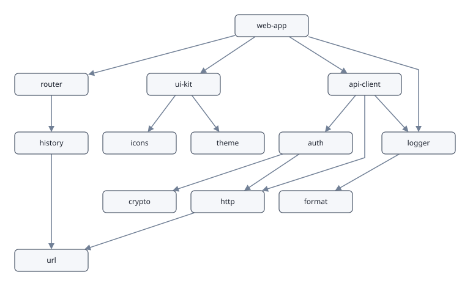

# Tutorial: a dependency tree

This tutorial draws the dependencies of a small program as a tree, first
from Go and then as an editable diagram in a web page. Along the way it
covers the ideas the rest of graphedwright is built on: a schema that
says what a diagram may hold, commands that change it and can be
undone, a layout, an SVG drawing, and a JSON file that saves it.



The Go program below is the example `Example_dependencyTree` in
[`example_test.go`](../example_test.go), which `go test` runs and checks
on every build, so it always works with the current code. The web page
is [`web/tutorial.html`](../web/tutorial.html).

You need Go 1.27 or later, as `go.mod` says. For the web page, you also need a browser
with WebAssembly, which is any current one.

## Part 1: in Go

### 1. Describe what the diagram may hold

A **schema** lists the kinds of vertex and edge a document may have, how
each is drawn and which attributes it carries. It is the palette of an
editor and the rules a document is checked against.

Here there is one kind of vertex, a package, with a free-text version
and a licence chosen from a list. There are two kinds of edge: a
dependency, and a dev dependency drawn dashed. `Acyclic` makes the
document refuse an edge that would make a cycle.

```go
schema := gw.Schema{
	VertexKinds: []gw.VertexKind{{
		Name:  "package",
		Shape: gw.RoundRect,
		Size:  gw.Size{W: 120, H: 36},
		Attrs: []gw.AttrSpec{
			{Key: "version", Kind: gw.Text},
			{Key: "licence", Kind: gw.Choice, Choices: []string{"MIT", "Apache-2.0", "BSD-3-Clause"}, Default: "MIT"},
		},
	}},
	EdgeKinds: []gw.EdgeKind{
		{Name: "depends on", Arrow: true},
		{Name: "dev dependency", Arrow: true, Dashed: true},
	},
	Acyclic: true, // a dependency cycle is refused
}
const pkg, dependsOn, devDependency = 0, 0, 1
```

Kinds are referred to by their index in the schema, so `pkg` is
`VertexKinds[0]`, `dependsOn` is `EdgeKinds[0]` and `devDependency` is
`EdgeKinds[1]`.

The imports used in this part are:

```go
import (
	gw "code.eitanity.com/graphedwright"
	"code.eitanity.com/graphedwright/doc"
	"code.eitanity.com/graphedwright/layout"
	"code.eitanity.com/graphedwright/svg"
)
```

### 2. Make a document and fill it with commands

`gw.New` makes an empty document for the schema. Every change to a
document is a **command** passed to `Apply`, which either applies it or
refuses it with an error and leaves the document as it was.

```go
d, err := gw.New(schema, gw.Caps{})
if err != nil {
	return err
}
add := func(name string) gw.VertexIndex {
	ch, err := d.Apply(gw.Command{Op: gw.AddVertex, Kind: pkg, ID: gw.ID(name), Text: name})
	if err != nil {
		return gw.None
	}
	return ch.Vertices[0]
}
link := func(kind gw.KindIndex, from, to gw.VertexIndex) error {
	_, err := d.Apply(gw.Command{Op: gw.AddEdge, Kind: kind, From: from, To: to, FromPort: gw.None, ToPort: gw.None})
	return err
}
app, cli, server := add("app"), add("cli"), add("server")
router, db, logs, testkit := add("router"), add("db"), add("log"), add("testkit")
for _, e := range [][2]gw.VertexIndex{{app, cli}, {app, server}, {server, router}, {server, db}, {cli, logs}, {router, logs}, {db, logs}} {
	link(dependsOn, e[0], e[1])
}
link(devDependency, app, testkit)
d.Apply(gw.Command{Op: gw.SetAttr, Vertex: db, Key: "version", Value: "2.4.1"})
```

A few things to notice:

- `Apply` returns a `Change` naming what the command touched. Its
  slices belong to the document and are only valid until the next
  `Apply`, so take what you need out of them straight away, as `add`
  does with `ch.Vertices[0]`.
- `gw.Caps{}` takes the default capacities: 4,096 vertices, 16,384 edges
  and so on. A document allocates everything it will ever hold when it
  is made, so edits never allocate; a command past a capacity is refused.
- These packages have no ports, so the edges name `gw.None` for both.
  A vertex kind with ports would need the edge to name which port it
  uses at that end.
- Each vertex and edge gets an ID. Here the packages are given their
  names as IDs; an edge gets a minted one (`e1`, `e2`, …).

### 3. Let the schema refuse what breaks it

The schema's rules hold for every command. Adding `log → app` would
close a cycle, and `"GPL"` is not one of the licence's choices:

```go
fmt.Println(link(dependsOn, logs, app))
_, err = d.Apply(gw.Command{Op: gw.SetAttr, Vertex: db, Key: "licence", Value: "GPL"})
fmt.Println(err)
```

```text
edge would make a cycle: log → app → cli → log
attribute "licence" of vertex "db" must be one of MIT, Apache-2.0, BSD-3-Clause
```

The errors name the rule and the elements involved, ready to show to a
user. Neither command changed the document.

### 4. Undo

Every applied command is recorded, and `Undo` and `Redo` walk the
record back and forth:

```go
d.Apply(gw.Command{Op: gw.Relabel, Vertex: db, Text: "database"})
d.Undo()
fmt.Println(d.Vertices[db].Label) // db
```

### 5. Lay it out, top to bottom

None of the packages has a position yet. The layered layout places
each vertex one layer below the furthest thing that depends on it,
orders each layer to cross few edges, and routes an edge that skips a
layer around the boxes in between.

A dependency tree reads top to bottom, so the `Layout` command names
that flow. The flow is saved with the document, and undoing the layout
puts the old flow back along with the old positions. `Text: "all"` lays
out every vertex, including any a user has placed by hand.

```go
d.Apply(gw.Command{Op: gw.Layout, Text: "all", Value: "top-to-bottom"})
res, err := layout.New(d.Caps()).Run(d, layout.Options{All: true})
if err != nil {
	return err
}
fmt.Println(res.Layers, "layers") // 4 layers
```

The `Layout` command records the old positions so that the layout can
be undone. `layout.Run` then sets the new ones. A `Layouter` allocates
its working space once, so keep one if you lay out often.

### 6. Draw it

`svg.Render` writes the whole drawing as SVG text. `Style` embeds the
default stylesheet so that the file looks right on its own. In a web
page you would link the stylesheet once instead.

```go
var picture bytes.Buffer
if err := svg.Render(d, svg.Options{Title: "Dependencies", Style: svg.Stylesheet}, &picture); err != nil {
	return err
}
os.WriteFile("deps.svg", picture.Bytes(), 0o644)
```

Every vertex and edge in the SVG is a `<g>` with its ID, classes from
its kind's name, and its attributes as `data-*`, so a page can style or
script it. The [Go API guide](go.md#svg) lists the classes.

### 7. Save it and read it back

The document format is JSON. It names the schema rather than embedding
it, so whoever reads it must supply the schema under that name.

```go
var text bytes.Buffer
if err := doc.Encode(d, "deps", &text); err != nil {
	return err
}
again, err := doc.Decode(text.Bytes(), doc.Options{Schemas: []doc.Named{{Name: "deps", Schema: schema}}})
```

The text looks like this, shortened:

```json
{"schema":"deps","flow":"top-to-bottom","vertices":[
  {"id":"app","kind":"package","label":"app","x":720,"y":0,"attrs":{"licence":"MIT"}},
  {"id":"db","kind":"package","label":"db","x":496,"y":192,"attrs":{"licence":"MIT","version":"2.4.1"}}, …],
 "edges":[{"id":"e1","kind":"depends on","from":"app","to":"cli"}, …,
  {"id":"e8","kind":"dev dependency","from":"app","to":"testkit"}],
 "view":{"x":0,"y":0,"w":0,"h":0}}
```

Every package has a licence, because the attribute has a default. An
edge that skips a layer, such as `cli → log`, also carries the
`"bends"` the layout routed it through, so that it is drawn the same
when it is read back.

The [format reference](format.md) describes every key. A document
without positions is laid out when it is read, which is how the web
page in part 2 starts.

## Part 2: in a web page

The same library compiles to WebAssembly and runs in the browser, where
it also edits. This part builds [`web/tutorial.html`](../web/tutorial.html)
and its script, [`web/tutorial.js`](../web/tutorial.js).
To try the finished page, run `make demo` and open
<http://127.0.0.1:8001/tutorial.html>.

### 1. Build and serve the browser build

```sh
GOOS=js GOARCH=wasm go build -o graphedwright.wasm ./cmd/graphedwright-wasm
cp "$(go env GOROOT)/lib/wasm/wasm_exec.js" .
```

Serve `graphedwright.wasm`, `wasm_exec.js`, the stylesheet
([`svg/graphedwright.css`](../svg/graphedwright.css)) and your page from
any web server. TinyGo builds a much smaller file (under 600 KB): use
`tinygo build -o graphedwright.wasm -target wasm -opt=z -no-debug
./cmd/graphedwright-wasm` together with TinyGo's own `wasm_exec.js`.

The page loads the stylesheet, gives the diagram's element a height,
and loads `wasm_exec.js` and its own script, which holds the code of the
steps below:

```html
<link rel="stylesheet" href="graphedwright.css">
<style> #graph { height: 520px; } </style>
<div id="graph"></div>
<div id="props"></div>
<script src="wasm_exec.js"></script>
<script src="tutorial.js"></script>
```

The script is a file rather than inline, so the page can run under a
strict [Content Security Policy](browser.md#content-security-policy).

### 2. Describe the schema in JavaScript

A page can describe a schema as a plain object, here the same one as in
part 1. Kinds that edges join or containers hold are named, not
numbered:

```js
const deps = {
  name: "deps",
  acyclic: true,
  vertexKinds: [
    { name: "package", shape: "round", w: 120, h: 36, attrs: [
      { key: "version", kind: "text" },
      { key: "licence", kind: "choice", choices: ["MIT", "Apache-2.0", "BSD-3-Clause"], default: "MIT" },
    ] },
  ],
  edgeKinds: [
    { name: "depends on", arrow: true },
    { name: "dev dependency", arrow: true, dashed: true },
  ],
};
```

### 3. A document to load

The document is the JSON format as an object. It has no positions and
says `flow: "top-to-bottom"`, so it is laid out top to bottom when it is
loaded.

```js
const tree = {
  schema: "deps",
  flow: "top-to-bottom",
  vertices: ["app", "cli", "server", "router", "db", "log", "testkit"].map((id) => ({ id, kind: "package", label: id })),
  edges: [
    ["app", "cli"], ["app", "server"], ["server", "router"], ["server", "db"],
    ["cli", "log"], ["router", "log"], ["db", "log"],
  ].map(([from, to]) => ({ kind: "depends on", from, to }))
    .concat([{ kind: "dev dependency", from: "app", to: "testkit" }]),
};
```

### 4. Start the WebAssembly and mount an editor

`graphedwright.create` mounts an editor in an element and returns a
handle. Every call returns `{ok: value}` or `{error: "reason"}`; none
throws.

```js
function ok(res) {
  document.getElementById("error").textContent = res.error || "";
  return res.error ? null : res.ok;
}

const go = new Go();
WebAssembly.instantiateStreaming(fetch("graphedwright.wasm"), go.importObject).then(({ instance }) => {
  go.run(instance);
  const g = ok(graphedwright.create(document.getElementById("graph"), { schema: deps, mode: "edit" }));
  ok(graphedwright.load(g, tree));
  graphedwright.on(g, "select", () => showProperties(g));
  graphedwright.on(g, "change", () => showProperties(g));
  graphedwright.on(g, "error", (msg) => { document.getElementById("error").textContent = msg; });
});
```

The diagram is now editable:

- **Drawing:** drag a package from the palette to add one. Drag from the
  edge of a box to another box to add a dependency, and click "dev
  dependency" in the palette first to draw that kind instead.
- **Moving and deleting:** drag a box to move it, and press Delete to
  remove what is selected.
- **Labels:** double-click a box, or select it and start typing, to
  rename it.
- **Undo:** Ctrl+Z undoes and Ctrl+Y redoes.

A dependency that would make a cycle is refused, and the refusal arrives
through the `error` callback.

### 5. A properties panel

When one package or dependency is selected, `graphedwright.properties(g)`
describes it: its kind, ID, label and attributes, each with what the
schema allows. `setLabel` and `setAttr` change it. They are commands
like any other, so the schema checks them and Ctrl+Z undoes them.

```js
function showProperties(g) {
  const box = document.getElementById("props");
  const p = ok(graphedwright.properties(g));
  if (!p) { box.innerHTML = "<p>Select a package or a dependency.</p>"; return; }
  box.replaceChildren();
  const heading = document.createElement("h3");
  heading.textContent = p.kind + " " + p.id;
  box.appendChild(heading);
  const field = (name, value, choices, commit) => {
    const label = document.createElement("label");
    label.textContent = name;
    const el = choices ? document.createElement("select") : document.createElement("input");
    for (const c of choices || []) el.appendChild(new Option(c, c));
    el.value = value;
    el.onchange = () => commit(el.value);
    el.onkeydown = (ev) => ev.stopPropagation(); // typing here is not the drawing's
    box.append(label, el);
  };
  field("label", p.label, null, (v) => ok(graphedwright.setLabel(g, v)));
  for (const a of p.attrs) {
    field(a.key, a.value, a.kind === "choice" ? a.choices : null, (v) => ok(graphedwright.setAttr(g, a.key, v)));
  }
}
```

Build the panel with DOM calls, as here, rather than HTML strings:
labels and attribute values are text a user typed.

### 6. Save what the user drew

`graphedwright.export(g)` returns the document as an object in the JSON
format. `graphedwright.svg(g)` returns the drawing as SVG text.

```js
const saved = JSON.stringify(ok(graphedwright.export(g)));
```

Load `saved` again with `graphedwright.load(g, saved)`, or read it in Go
with `doc.Decode` as in part 1.

## Where next

- **[Concepts](concepts.md):** documents, schemas, commands and undo,
  containers, layout flow and edge routing.
- **[Schemas](schemas.md):** every option, and the built-in schemas for
  general diagrams, use case diagrams and threat models.
- **[Browser guide](browser.md):** the JavaScript API and how the editor
  behaves.
- **[Go API guide](go.md):** the packages, the renderer and the editor
  from Go.
- **[Document format](format.md)** and **[command line](cli.md)**.
